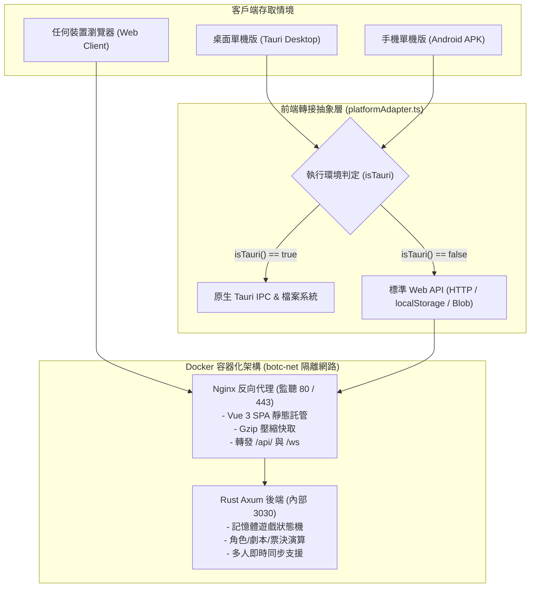

# Blood on the Clocktower (BOTC) Web Server 容器化架構與公網部署手冊

本文件為 **BOTC Web 伺服器版** 的核心架構 Wiki，完整記載系統設計、前後端雙模適配原理、Docker 容器化拓撲、自動化驗證機制以及將應用發布至公網（Public Internet）的操作指南。

---

## 目錄
1. [架構總覽與雙模運作模式](#1-架構總覽與雙模運作模式)
2. [前端平台轉接層 (Platform Adapter) 設計](#2-前端平台轉接層-platform-adapter-設計)
3. [後端 Rust Axum 遊戲引擎與 API 規範](#3-後端-rust-axum-遊戲引擎與-api-規範)
4. [全容器化拓撲與部署架構](#4-全容器化拓撲與部署架構)
5. [自動化測試與回歸驗證體系 (CP1 ~ CP5)](#5-自動化測試與回歸驗證體系-cp1--cp5)
6. [公網發布指南 (Public Internet Exposure)](#6-公網發布指南-public-internet-exposure)
   - [方案 A（推薦）：Cloudflare Zero Trust Tunnel（免固定 IP / 免開 Port / 免費 SSL）](#方案-a推薦cloudflare-zero-trust-tunnel)
   - [方案 B：雲端 VPS (Ubuntu/Debian) 直接部署 + Let's Encrypt](#方案-b雲端-vps-直接部署--lets-encrypt)
   - [方案 C：家用寬頻 DDNS + 路由器 Port Forwarding](#方案-c家用寬頻-ddns--路由器-port-forwarding)
7. [日常運維與維護手冊](#7-日常運維與維護手冊)

---

## 1. 架構總覽與雙模運作模式

BOTC 系統採用 **「一套核心代碼，雙模無縫運作」** 的架構理念，完全相容兩種運行情境：
1. **單機版**：Tauri 桌面端（Windows / macOS / Linux）與 Android 行動版（APK）。
2. **Web 伺服器版**：Docker 容器化部署，透過 Nginx 統一託管前端靜態檔案並反向代理後端 Rust Axum 伺服器。



---

## 2. 前端平台轉接層 (Platform Adapter) 設計

為避免純網頁模式因呼叫 `@tauri-apps/*` 原生模組而發生崩潰，所有平台相依操作皆由 `src/utils/platformAdapter.ts` 集中封裝：

| 功能項目 | Tauri 單機版模式 (`isTauri() === true`) | Web 伺服器模式 (`isTauri() === false`) |
| :--- | :--- | :--- |
| **環境探測** | 偵測 `window.__TAURI_INTERNALS__` | 未偵測到原生注入，判定為瀏覽器環境 |
| **指令呼叫** | 動態調用 `@tauri-apps/api/core.invoke` | 發送 HTTP `POST /api/game/action` 至後端 |
| **資料儲存** | 調用 `@tauri-apps/plugin-fs` 讀寫本機檔案 | 調用瀏覽器 `localStorage` / `IndexedDB` |
| **檔案匯出** | 調用 `@tauri-apps/plugin-dialog` 儲存對話框 | 產生記憶體 `Blob` 並觸發瀏覽器下載 |
| **系統通知** | 調用 `@tauri-apps/plugin-notification` | 調用瀏覽器標準 `Notification API` |
| **授權驗證** | 調用原生許可證硬體鎖校驗邏輯 | 預設視為合法授權，由伺服器端集中管控 |

---

## 3. 後端 Rust Axum 遊戲引擎與 API 規範

後端使用高興能且記憶體安全的 Rust 語言打造，基於 Axum 框架提供非同步 HTTP 與 WebSocket 支援：

### 核心 API 端點

#### 1. 健康檢查
- **路徑**：`GET /`
- **回應**：`HTTP 200 OK`
- **內文**：`"BOTC Server is running"`

#### 2. 獲取遊戲魔典當前完整狀態
- **路徑**：`GET /api/game/state`
- **回應格式**：
  ```json
  {
    "code": 200,
    "message": "success",
    "data": {
      "phase": "Setup",
      "round": 0,
      "players": [],
      "script": null,
      "current_nomination": null,
      "history": []
    }
  }
  ```

#### 3. 執行遊戲操作指令
- **路徑**：`POST /api/game/action`
- **請求格式**：
  ```json
  {
    "action": "add_player",
    "payload": {
      "id": "p1",
      "name": "說書人小林"
    }
  }
  ```
- **支援的 Action 指令集**：
  - `new_game`: 重置魔典狀態
  - `add_player`: 新增玩家
  - `remove_player`: 移除玩家
  - `update_player`: 更新玩家角色或狀態
  - `set_script`: 載入自訂劇本
  - `start_nomination`: 發起處決提名
  - `cast_vote`: 記錄玩家投票
  - `finish_nomination`: 結算處決票數
  - `next_phase`: 推進遊戲日夜階段

---

## 4. 全容器化拓撲與部署架構

系統透過 `docker-compose.yml` 統籌管理兩個核心服務容器，宿主機**無須安裝 Nginx** 即可完成全部署：

```
       [ 網際網路 / 使用者瀏覽器 ]
                   │
                   ▼ (Port 80 / 443)
       ┌────────────────────────┐
       │   Docker: botc-nginx   │ (託管 dist/ 靜態檔 + 代理路由)
       └───────────┬────────────┘
                   │ 內部虛擬網路 (botc-net: bridge)
                   ▼ (內部 http://server:3030)
       ┌────────────────────────┐
       │   Docker: botc-server  │ (Rust Axum 遊戲引擎，非 root 安全帳號)
       └────────────────────────┘
```

### 快速啟動指令
```bash
# 1. 建置前端靜態資源
npm run build

# 2. 啟動所有容器 (後台執行並自動編譯 Rust)
docker compose up -d --build

# 3. 檢視運作狀態
docker compose ps

# 4. 停止所有容器
docker compose down
```

---

## 5. 自動化測試與回歸驗證體系 (CP1 ~ CP5)

專案內建嚴謹的自動化回歸測試體系，每次更動皆可透過單一指令一鍵驗證全系統健全度：

```bash
# 執行全流程回歸測試 (依序執行 CP1 ~ CP5)
npm run verify:all
```

| 檢查點 | 驗證指令 | 涵蓋驗證範圍 |
| :--- | :--- | :--- |
| **CP1** | `npm run verify:cp1` | Rust Axum 基礎健康檢查、單機版 Cargo workspace 隔離保護。 |
| **CP2** | `npm run verify:cp2` | 前端雙模轉接層單元測試、全專案 TypeScript 嚴格型別校驗 (`vue-tsc`)。 |
| **CP3** | `npm run verify:cp3` | Rust 遊戲狀態機單元測試 (`cargo test`)、HTTP 魔典 API 實際連線測試。 |
| **CP4** | `npm run verify:cp4` | Nginx 配置規格測試（SPA 路由、API 反代、WebSocket、Gzip 壓縮）。 |
| **CP5** | `npm run verify:cp5` | 多階段建置 Dockerfile 安全審查、Docker Compose 服務拓撲校驗。 |

---

## 6. 公網發布指南 (Public Internet Exposure)

要將部署在本地或伺服器上的 BOTC Web 版開放給公網上的好友或社群玩家遊玩，有以下三種途徑：

### 方案 A（推薦）：Cloudflare Zero Trust Tunnel
> **優勢**：
> 1. **零 Port 轉發**：路由器完全不需要打開任何 Port，極度安全。
> 2. **免固定 IP**：支援動態 IP 與 CGNAT 家用寬頻。
> 3. **全自動 HTTPS**：由 Cloudflare 全球邊緣節點自動簽發免費 SSL 憑證。
> 4. **天然抗 DDoS 防護**：隱藏真實主機 IP，杜絕惡意流量攻擊。

#### 操作步驟：
1. 前往 [Cloudflare Zero Trust 控制台](https://one.dash.cloudflare.com/)，註冊或登入。
2. 進入 **Networks** > **Tunnels**，點擊 **Create a Tunnel**。
3. 命名 Tunnel（例如：`botc-game-tunnel`），選擇 **Docker** 部署類型。
4. 複製官方提供的 Tunnel Token。
5. 在 `docker-compose.yml` 中新增 `cloudflared` 服務：
   ```yaml
     cloudflared:
       image: cloudflare/cloudflared:latest
       container_name: botc-cloudflared
       restart: unless-stopped
       command: tunnel run --token YOUR_CLOUDFLARE_TUNNEL_TOKEN
       networks:
         - botc-net
       depends_on:
         - nginx
   ```
6. 在 Cloudflare 控制台設定 **Public Hostname**：
   - **Subdomain**：`botc`（例如：`botc.yourdomain.com`）
   - **Service**：`HTTP`
   - **URL**：`nginx:80`
7. 執行 `docker compose up -d`，玩家即可透過 `https://botc.yourdomain.com` 直接連線！

---

### 方案 B：雲端 VPS (Ubuntu/Debian) 直接部署 + Let's Encrypt
適用於擁有一台雲端主機（如 Linode、DigitalOcean、AWS EC2、GCP）並持有獨立網域的情況。

#### 操作步驟：
1. **將網域 A 記錄指向 VPS 伺服器公網 IP**。
2. **在 VPS 上安裝 Docker 與 Git**：
   ```bash
   sudo apt update && sudo apt install -y docker.io docker-compose-plugin git
   ```
3. **複製專案並編譯部署**：
   ```bash
   git clone <REPO_URL> /opt/botc
   cd /opt/botc
   npm run build
   docker compose up -d --build
   ```
4. **申請 SSL/TLS 憑證 (Certbot)** 或將網域 DNS 託管在 Cloudflare 並開啟 Proxy（橙色雲朵）即可享有免費 HTTPS。

---

### 方案 C：家用寬頻 DDNS + 路由器 Port Forwarding
適用於無預算購買 VPS，但家中寬頻具備公網動態 IPv4 / IPv6 的玩家。

#### 操作步驟：
1. **設定 DDNS (動態網域名稱解析)**：
   - 透過 No-IP 或 DuckDNS 取得免費域名，並在路由器或本機安裝更新客戶端。
2. **路由器設定虛擬伺服器 (Port Forwarding)**：
   - 外部 Port：`80`（HTTP）與 `443`（HTTPS）
   - 內部 IP：執行 Docker 主機的內網 IP（如 `192.168.1.100`）
   - 內部 Port：`80`
3. **安全注意**：請確保作業系統防火牆規則僅放行特定連接埠，並建議搭配 Cloudflare CDN 加密反代保護源站 IP。

---

## 7. 日常運維與維護手冊

### 容器日誌查看
```bash
# 查看所有容器的即時日誌
docker compose logs -f

# 僅查看後端 Rust 伺服器日誌
docker compose logs -f server

# 僅查看 Nginx 存取日誌
docker compose logs -f nginx
```

### 系統更新與熱部署
```bash
# 1. 抓取最新程式碼
git pull

# 2. 重新構建前端
npm run build

# 3. 重新構建並滾動重啟服務
docker compose up -d --build
```
